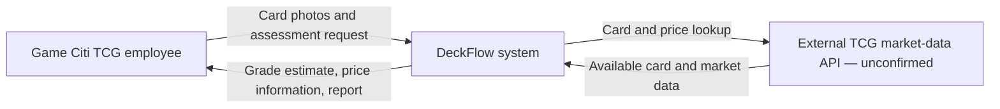
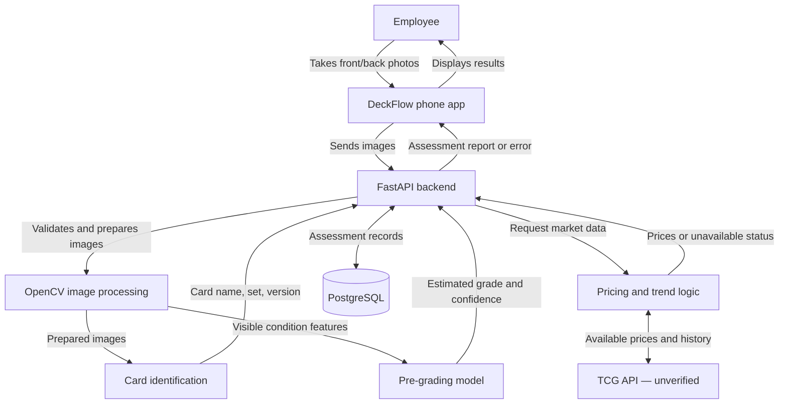
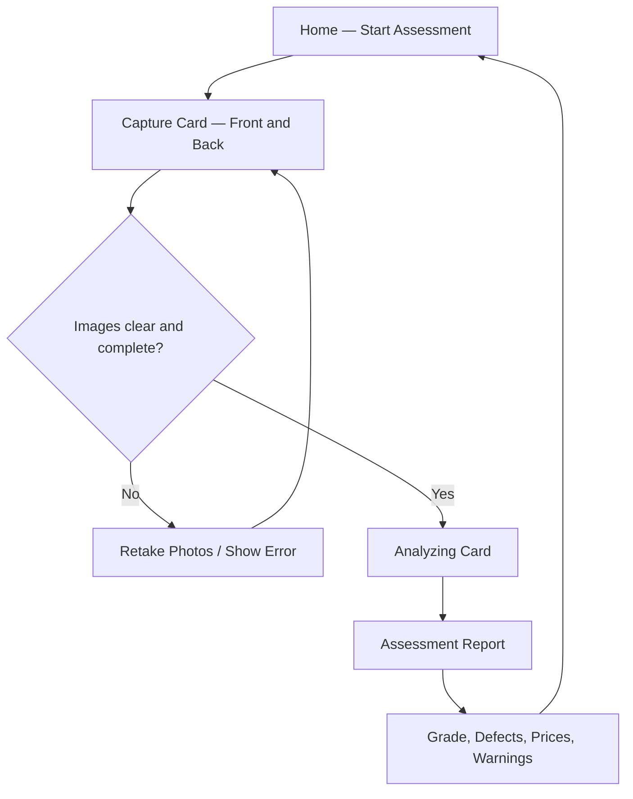

# Responsibilities

- **Team Lead: Raul Munoz**
  - Keeps the team on schedule and handles the final push to the main branch.
- **Client Lead: Jovanny Reyes**
  - Communicates with Game Citi TCG and makes sure the project meets the client's needs.
- **Technical Lead: Isaac Parada**
  - Reviews code, checks how the components connect, and makes sure the final system works.
- **Writing Lead: Anthony Jimenez**
  - Organizes project documents, checks writing deadlines, and reviews documents before they are submitted.

# Technology Stack

## Frontend

**React Native (proposed; final mobile framework to be confirmed by the team)**

- Build the phone app where employees take pictures of cards and view results.

## Backend

**Python with FastAPI**

- Receive images submitted by the phone app and coordinate the card analysis and pricing features.

## Image Processing

**OpenCV**

- Detect card boundaries, measure centering, and help find visible defects.

## Database

**PostgreSQL**

- Store card details, assessment results, and relevant pricing information.

## Market Information

**TCG API**

- Retrieve available card prices for supported trading card games.
- Confirm that the API provides the exact card versions, historical prices, and grade-specific prices needed by DeckFlow.
- The stated free tier of 100 requests per day and coverage of 57+ games still need to be verified.

# System Workflow

1. Employee takes pictures of the front and back of a card using the phone app.
2. Backend checks that the images are usable.
3. System identifies the card's name, set, and version.
4. Image processing and the grading model evaluate its condition.
5. System retrieves available market information.
6. System estimates a selling price and suggests when to sell, if enough data exists.
7. Employee views an assessment report.

# Design Diagrams

These diagrams show the proposed phone-app design based on the technology stack and workflow above. React Native and the market-data API still need team confirmation. The diagrams can be edited directly in this Markdown file and displayed by GitHub.

## Design 1: System Context

Shows who uses DeckFlow and which outside service it may need. DeckFlow is shown as one system here; its internal components appear in Design 2.

## Design 2: App and Backend Components

Shows how the proposed parts communicate. The mobile app takes photos and displays the report; the FastAPI backend coordinates the analysis and data access.

## Design 3: Mobile App Screen Flow

A simple proposed screen layout for the demo. It shows the main user journey, not final visual styling.

# Card Identification

- Use the images taken through the phone app to identify the card's name, set, and version.
- Use image processing to crop and prepare the card image.
- Compare card details against supported card information.
- Ask for a clearer image or manual confirmation if identification is uncertain.
- **PRD target:** Identify at least 90% of supported cards correctly.

# Card Pre-Grading

- Analyze both the front and back images.
- Look for centering issues, corner damage, edge wear, and visible surface defects.
- Use the detected features and an AI model to estimate a grade from 1 to 10.
- Show the detected defects and how confident the system is in the estimate.
- **PRD target:** At least 85% of estimated grades must be within one grade of a known professional grade.
- **PRD target:** At least 95% of repeated valid scans of the same card should produce the same grade.
- Grades are unofficial and do not replace PSA, TAG, or other professional graders.

# Market Pricing

- Use the selected TCG market-data API to look up the identified card.
- Retrieve available market prices and use them to estimate a selling price.
- Update price suggestions when new market data is available.
- Show when the market data was last updated.
- If prices are missing or unreliable, tell the employee instead of guessing.

# Selling Time Frame

- Use historical market prices, if available, to look for price trends.
- Compare recent prices with older prices to help suggest selling now or considering a later sale.
- Do not make a timing recommendation if there is not enough reliable history.
- The team still needs to choose the exact trend-analysis method.

# Assessment Report

- Display the card's name, set, and version.
- Show the unofficial grade and visible defects.
- Show estimated market value and suggested selling price.
- Show a suggested selling time frame when supported by data.
- Warn the employee when an image, grade, or price estimate is uncertain.

# Data Storage

- Use PostgreSQL to save card information and assessment results.
- Store the estimated grade, detected defects, and pricing details for each assessment.
- Decide whether to save the original images or only references to them.
- Decide how long saved images and reports should be kept.

# Testing

- **Card identification:** Test known cards and check whether at least 90% are identified correctly.
- **Grading:** Compare estimated grades with professional grades; target at least 85% within one grade.
- **Repeatability:** Scan the same cards multiple times; target 95% same-grade results.
- **Reliability:** Check that at least 90% of valid scans finish without system failure.
- **Speed:** Aim to generate a report within 15 seconds after valid images are submitted from the app. The PRD also requires 90% of valid scans to finish within 30 seconds.
- **Bad inputs:** Test blurry images, missing images, and unsupported cards to make sure the system reports the problem.

# Implementation Plan

1. Test camera quality and collect sample card images.
2. Build the mobile app camera screen and backend image-upload route.
3. Implement card identification.
4. Develop and test the pre-grading component.
5. Connect market pricing and selling recommendations.
6. Generate the assessment report and save results.
7. Test the complete system against the PRD requirements.

# Risks and Open Questions

- Can phone cameras capture enough detail to detect small defects?
- Can the model consistently tell the difference between high grades, such as 9 and 10?
- Do we have enough legally usable images with known professional grades?
- Which card games and sets will the first version support?
- Does the selected TCG API provide the prices and history we need?
- How will we calculate a reliable selling time frame?
- What equipment and operating costs will be acceptable to Game Citi TCG?

# Out of Scope

- DeckFlow will not issue official professional grades.
- DeckFlow will not guarantee a grade from PSA, TAG, or CGC.
- DeckFlow will not automatically submit cards for professional grading or sell them.
