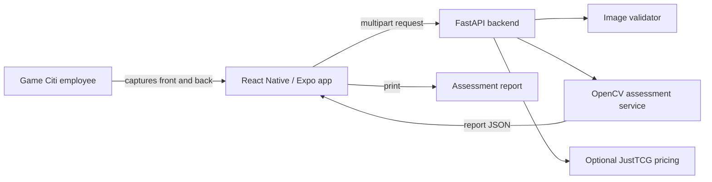

# DeckFlow Demo

DeckFlow is a React Native/Expo, AI-assisted trading-card pre-grading concept for Game Citi TCG. The same frontend runs as a phone app and in a MacBook web browser. This demo follows the workflow in `Docs/design.md`: capture the front and back, validate the images, confirm a supported card, generate an unofficial pre-grade, display cached market information, and save the report to session history.

This is a CPSC 490 demonstration, not a professional grading service. Camera capture, uploads, validation, computer-vision measurements, the API, error handling, and session history are working software. Automatic card recognition and a trained grading model are future components.

## Requirements

- Docker Desktop 4.x or newer
- macOS, Windows, or Linux
- About 1 GB of free disk space for the first container build
- No API key is required for grading; a JustTCG key is optional for live prices

The containers use Python 3.12, Node.js 22, Expo SDK 58, and React Native 0.88. Docker handles these versions and dependencies automatically.

## Clone and run

```bash
git clone https://github.com/raulmunoz0711/DeckFlow.git
cd DeckFlow
docker compose up --build
```

After both services start, open:

```text
http://localhost:5173
```

The first build can take several minutes. Later runs are faster.

For live JustTCG prices, copy `.env.example` to `.env`, replace the placeholder with your key, and restart Docker. The key stays in the backend and is never exposed to the browser.

## Optional phone run

From `frontend`, run `npm install` and then `npx expo start`. Open the project through Expo Go on a phone connected to the same network. Set `EXPO_PUBLIC_API_URL` to the computer's LAN address, such as `http://192.168.1.20:8000`, because `localhost` on a phone points to the phone itself.

## Run the demonstration

1. Choose one of the three supported demonstration cards. This confirmation step represents the design document's manual fallback when automatic identification is uncertain.
2. For a live scan, click **Use camera** under Front, allow browser camera access, align the card with the guide, and click **Capture Front**. Repeat for Back. You can also select saved images or use the included samples.
3. Click **Analyze card**.
4. DeckFlow measures focus, glare, centering, corner consistency, and possible edge whitening to calculate an unofficial 1–10 pre-grade. It displays live JustTCG pricing when configured, otherwise cached demo prices.
5. The completed report appears in **Recent assessments** and can be reopened or printed.

To test bad input, upload a text file renamed with a `.txt` extension or an image smaller than 100 bytes. The app should show an error instead of producing a grade.

## To stop software
```bash
docker compose down
```

## What is real and what is mocked

Working in this version:

- React Native/Expo interface for iOS, Android, and web
- Front and back image uploads
- Live MacBook webcam capture for a real card front and back
- File-type, file-size, and missing/invalid-input checks
- FastAPI assessment endpoint
- Assessment report and print view
- Employee-confirmed identification from a limited supported-card list
- Pixel-based computer-vision pre-grade that changes with the submitted images
- Measured focus, glare, darkness, centering, corners, and edge whitening
- Optional JustTCG v2 raw-condition and nearest-PSA-grade pricing
- Recent assessment session history
- Automated API tests
- Docker startup on Apple-silicon and Intel computers

Not yet implemented:

- Automatic card identification
- A trained machine-learning grade predictor validated against PSA/CGC labels
- Scratch detection under controlled angled lighting
- Automatic card identification from unrestricted cards

These mocked components are the next development targets. They are clearly separated in the backend so each can be replaced without changing the user flow.

## Architecture



## API

- `GET /api/health` checks whether the backend is running.
- `GET /api/cards` returns the supported demonstration cards.
- `GET /api/assessments` returns recent in-memory session reports.
- `POST /api/assessments` accepts `front`, `back`, and `card_id`, then returns the assessment report.
- Interactive API documentation is available at `http://localhost:8000/docs`.
