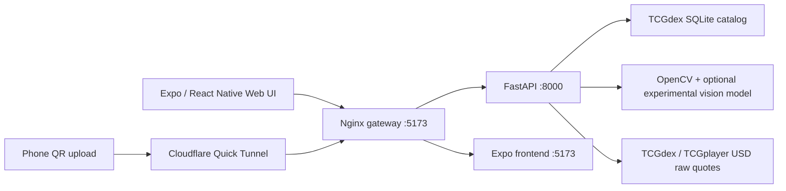

# DeckFlow — Pokémon Card Pre-Grading Prototype

DeckFlow is a **CPSC 490 experimental prototype** for identifying Pokémon cards, analyzing front/back photos, and displaying an unofficial condition estimate alongside available raw-card market pricing. It is **not** an official PSA/CGC grade, appraisal, or professional grading service.

## What it currently does

- Scan or upload front and back card photos from the web interface or through a phone-upload QR session.
- Crop the card and analyze visual indicators such as centering, corners, edges, image quality, and possible surface wear.
- Search a local **TCGdex SQLite** Pokémon catalog (English and Japanese records when synced). Confirm the printing if results are ambiguous.
- Retrieve **USD TCGplayer raw market pricing through TCGdex** when a supported printing has a price; cache returned prices.
- Display an experimental estimated grade and assessment report. **Graded/PSA resale prices are not supplied by TCGdex** and are not fabricated.
- Choose one of three sample cards (Charizard V, Exeggcute, Psyduck) for demonstration.
- Show a Pikachu loading animation while analyzing cards.

**Limitations:** Card recognition, photo orientation/cropping, and damage grades are not fully reliable. Lighting, holographic effects, glare and image quality can change the estimated grade. Some cards have no USD quote. Do not use the estimate as a guaranteed grade or valuation.

## Requirements

- Docker Desktop with Docker Compose
- Internet access for the first image build, catalog sync, optional market quotes, and Cloudflare QR tunnel
- A modern desktop browser (the local UI is at `http://localhost:5173`)

The Docker images install the project's Python and Node dependencies.

## Start the project

```bash
git clone https://github.com/raulmunoz0711/DeckFlow.git
cd DeckFlow
# Switch to the development branch if testing Isaac's current prototype:
git switch Isaac-Parada---Technical-Lead
docker compose up --build -d
```

Then visit **http://localhost:5173**.

If you already cloned the repository, pull the branch's latest changes before rebuilding. Avoid `docker compose down -v` if you need to preserve downloaded model data.

### Environment configuration

The backend currently uses **TCGdex for identification/pricing**, which does **not** require a JustTCG API key. The Compose configuration also accepts an optional `JUSTTCG_API_KEY` environment variable for legacy/optional functionality, but **adding a JustTCG key does not change the active TCGdex price provider**.

For local environment configuration:

```bash
cp .env.example .env
```

Check the `.env` values for your machine. Do **not** put actual credentials in documentation, bug reports, or screenshots. `.env` should remain untracked by Git.

## Sync the Pokémon catalog

The backend needs the local catalog for reliable lookup:

```bash
docker compose exec backend python sync_catalog.py --languages en ja
curl http://localhost:5173/api/catalog-status
```

The status endpoint should return `"ready": true` with a nonzero `"cards"` count. The catalog is saved in `./catalog_data`, mounted into the backend. Do not rerun the complete sync for every scan.

TCGdex data may use a different set total than the number printed in a demo card. The search logic accounts for this but still requires confirmation if a printing cannot be identified unambiguously.

## Test the demo

1. On **http://localhost:5173**, choose Charizard V, Exeggcute, or Psyduck under **Try a sample card**.
2. Click **Analyze real card** after the sample photos have loaded.
3. Check the identified name and printing. If multiple candidates are offered, choose the correct printing.
4. Review the experimental grade, visible-defect indicators and available **raw** market quote.
5. Alternatively, scan the phone-upload QR code, upload both sides and analyze the received photos.

The phone upload feature uses a temporary Cloudflare Quick Tunnel. Its URL can change across restarts; it is intended for development/classroom demonstration and should not be treated as a secure production upload service.

## Run tests

To run the current focused integration suite:

```bash
docker compose exec -w /app backend python -m pytest -q tests/test_catalog_integration.py
```

This suite covers catalog matching and a **mocked** integration path for pricing. Passing it does **not** prove live price availability or real-world grading accuracy.

To run all existing backend tests:

```bash
docker compose exec -w /app backend python -m pytest -q
```

Some older tests still assume the previous JustTCG/hardcoded-demo behavior and may fail until updated. The physical-card grading algorithm also needs further validation. Do not interpret those test failures as proof the Docker server failed to start.

## Stop or restart

```bash
docker compose down
docker compose up --build -d
```

Avoid `docker compose down -v`, which can delete Docker-managed cached model data. The catalog is kept in the `catalog_data` bind mount.

## Architecture



### What is the gateway?

`gateway/nginx.conf` configures the **Nginx reverse proxy**. It listens inside the container on port 8080, exposed on your Mac as **localhost:5173**. It routes:
- `/api/` requests to the Python backend on port 8000.
- All other web requests to the Expo frontend on port 5173.

This keeps the frontend and backend reachable through one browser address and gives the Cloudflare tunnel a single destination. **Its GitHub “last updated” time being older is normal** if the routing hasn't changed; it does not need to be edited merely to update its timestamp.

## Useful checks

```bash
docker compose ps
curl http://localhost:5173/api/health
curl http://localhost:5173/api/catalog-status
docker compose logs --tail=80 backend
docker compose logs --tail=80 frontend
```

## Project layout

- `backend/` — FastAPI endpoints, catalog, identification, pricing, vision grading, and tests
- `frontend/` — Expo UI, samples, QR upload flow, loading animation
- `gateway/` — Nginx routes between the UI and API
- `sample_data/` — demo assets
- `catalog_data/` — local SQLite catalog, generated after sync; not intended for source control
- `Docs/` — course/project documentation
- `compose.yaml` — starts the services
- `.env.example` — configuration example; `.env` is your local runtime configuration

## Known next steps

- Validate condition predictions against a properly labeled real-card dataset, especially clean vs damaged examples.
- Improve rotation, crop validation, and low-quality image handling for phone uploads.
- Strengthen identity disambiguation using collector number, set and reference art.
- Modernize legacy tests and improve production security before any deployment outside a classroom demo.
